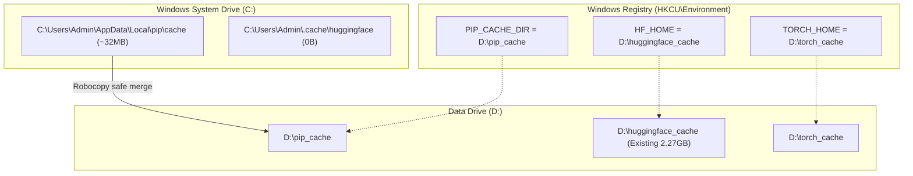

# Redirect AI & Python Caches to Drive D Implementation Plan

> **For agentic workers:** REQUIRED SUB-SKILL: Use superpowers:subagent-driven-development to implement this plan task-by-task. Steps use checkbox (`- [ ]`) syntax for tracking.

**Goal:** Safely redirect all HuggingFace, PyTorch, and Pip caches from Drive C to Drive D and permanently configure Windows environment variables with a strict zero-data-loss guarantee.

**Architecture:** We utilize standard Windows user environment variables (`HF_HOME`, `TORCH_HOME`, `PIP_CACHE_DIR`) to point the respective tooling directly to pre-existing and dedicated folders on Drive D. Before changing or cleaning anything on Drive C, all existing cached data will be non-destructively synced to Drive D using `robocopy`, verified for integrity, and tested before any deletion of obsolete data occurs.

**Architecture Diagram:**



**Tech Stack:** Windows CMD / PowerShell, Windows User Registry (`HKCU\Environment`), Robocopy, Python 3.12, Pip, Hugging Face Hub, PyTorch.

---

### Task 1: Audit and Non-Destructive Sync of Existing Caches

**Files & Directories:**
- Source Pip: `C:\Users\Admin\AppData\Local\pip\cache`
- Source Hugging Face: `C:\Users\Admin\.cache\huggingface`
- Destination Pip: [D:\pip_cache](file:///d:/pip_cache)
- Destination Hugging Face: [D:\huggingface_cache](file:///d:/huggingface_cache)
- Destination Torch: [D:\torch_cache](file:///d:/torch_cache)

- [x] **Step 1: Ensure destination directories exist on Drive D**

Run in terminal:
```cmd
if not exist "D:\pip_cache" mkdir "D:\pip_cache"
if not exist "D:\huggingface_cache" mkdir "D:\huggingface_cache"
if not exist "D:\torch_cache" mkdir "D:\torch_cache"
```
Expected: Folders exist without errors.

- [x] **Step 2: Non-destructively sync existing pip cache from C: to D:**

Run in terminal:
```cmd
robocopy "C:\Users\Admin\AppData\Local\pip\cache" "D:\pip_cache" /E /XC /XN /XO /NP /NFL /NDL
```
> [!NOTE]
> `robocopy` return codes 0-3 mean successful copy/matching. It never deletes existing files in the destination.

- [x] **Step 3: Verify destination file count and integrity**

Run PowerShell:
```powershell
$sourceFiles = (Get-ChildItem -Path "C:\Users\Admin\AppData\Local\pip\cache" -Recurse -File -ErrorAction SilentlyContinue).Count
$destFiles = (Get-ChildItem -Path "D:\pip_cache" -Recurse -File -ErrorAction SilentlyContinue).Count
Write-Output "Source files: $sourceFiles, Dest files: $destFiles"
```
Expected: `destFiles` >= `sourceFiles`.

---

### Task 2: Configure Windows User Environment Variables

**Registry Target:** `HKEY_CURRENT_USER\Environment`

- [x] **Step 1: Set User Environment Variables via `reg add`**

Run in terminal:
```cmd
reg add HKCU\Environment /v HF_HOME /t REG_SZ /d "D:\huggingface_cache" /f
reg add HKCU\Environment /v TORCH_HOME /t REG_SZ /d "D:\torch_cache" /f
reg add HKCU\Environment /v PIP_CACHE_DIR /t REG_SZ /d "D:\pip_cache" /f
```
Expected: `The operation completed successfully.` for all 3 commands.

- [x] **Step 2: Verify registry keys are stored accurately**

Run in terminal:
```cmd
reg query HKCU\Environment /v HF_HOME
reg query HKCU\Environment /v TORCH_HOME
reg query HKCU\Environment /v PIP_CACHE_DIR
```
Expected:
```
HF_HOME       REG_SZ    D:\huggingface_cache
TORCH_HOME    REG_SZ    D:\torch_cache
PIP_CACHE_DIR REG_SZ    D:\pip_cache
```

- [x] **Step 3: Broadcast WM_SETTINGCHANGE so running explorer/apps receive the update**

Run PowerShell:
```powershell
Add-Type -Namespace Win32 -Name NativeMethods -MemberDefinition @"
[DllImport("user32.dll", SetLastError = true, CharSet = CharSet.Auto)]
public static extern IntPtr SendMessageTimeout(IntPtr hWnd, uint Msg, UIntPtr wParam, string lParam, uint fuFlags, uint uTimeout, out UIntPtr lpdwResult);
"@
$HWND_BROADCAST = [IntPtr]0xffff
$WM_SETTINGCHANGE = 0x001A
$result = [UIntPtr]::Zero
[Win32.NativeMethods]::SendMessageTimeout($HWND_BROADCAST, $WM_SETTINGCHANGE, [UIntPtr]::Zero, "Environment", 2, 5000, [ref]$result)
```
Expected: Return code indicating message broadcast without error.

---

### Task 3: Functional Verification of Redirection

**Files:**
- Test verification script: temporary check in current session

- [x] **Step 1: Verify Pip cache directory resolution**

Run in terminal:
```cmd
set "PIP_CACHE_DIR=D:\pip_cache"
pip cache dir
```
Expected output:
```
D:\pip_cache
```

- [x] **Step 2: Verify Python runtime environment picks up HuggingFace & Torch paths**

Run in terminal:
```cmd
set "HF_HOME=D:\huggingface_cache"
set "TORCH_HOME=D:\torch_cache"
python -c "import os; print('HF_HOME:', os.environ.get('HF_HOME')); print('TORCH_HOME:', os.environ.get('TORCH_HOME'))"
```
Expected output:
```
HF_HOME: D:\huggingface_cache
TORCH_HOME: D:\torch_cache
```

- [x] **Step 3: Test a lightweight Hugging Face Hub path resolution**

Run in terminal:
```cmd
set "HF_HOME=D:\huggingface_cache"
python -c "from huggingface_hub.constants import HF_HUB_CACHE; print('Resolved HF Cache:', HF_HUB_CACHE)"
```
Expected output starting with `D:\huggingface_cache\hub`.

---

### Task 4: Safe Cleanup of Obsolete Cache on Drive C

> [!CAUTION]
> This step MUST only be executed after Task 1, 2, and 3 pass all verification checks.

- [x] **Step 1: Check current free space on C: drive**

Run in terminal:
```cmd
powershell -Command "Get-PSDrive C | Select-Object Used, Free"
```

- [x] **Step 2: Safely remove the duplicated pip cache on Drive C**

Run in terminal:
```cmd
rd /s /q "C:\Users\Admin\AppData\Local\pip\cache"
```

- [x] **Step 3: Remove empty HuggingFace folder on Drive C**

Run in terminal:
```cmd
if exist "C:\Users\Admin\.cache\huggingface" rd /s /q "C:\Users\Admin\.cache\huggingface"
```

- [x] **Step 4: Verify that Drive C free space is preserved and increased**

Run in terminal:
```powershell
powershell -Command "Get-PSDrive C, D"
```
Expected: Drive C free space >= 15.65 GB.

---

### Task 5: Document Rules for Future Sessions

**Files:**
- Document file: [docs/CACHE_GUIDE.md](file:///d:/AD/Visualize/docs/CACHE_GUIDE.md)

- [x] **Step 1: Create a quick reference guide in docs/CACHE_GUIDE.md**
Document the locations of caches on Drive D and reminders for virtual environment setups in future projects.
